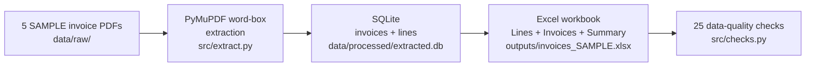

# P6 — PDF → Excel Conversion Pipeline

**Repo:** https://github.com/mhkh-stock/p6-pdf-to-excel-conversion

**Client pain:** invoices and reports arrive as PDFs; somebody re-types
every line into Excel by hand — slow, and one mistyped zero ruins a
month's accounts.
**This delivery:** 5 SAMPLE invoice PDFs → one structured Excel
workbook, extracted by code, never re-typed. **Status: SAMPLE delivery**
**Tools:** Python · PyMuPDF (word-box extraction) · SQLite · openpyxl
**Deliverable:** `outputs/invoices_SAMPLE.xlsx` (20 lines, 5 invoices)
**Database:** `data/processed/extracted.db`

> ⚠️ **What this is and is not.** The supplier (Karachi Office
> Supplies) and all five buyers are fictional, and the PDFs were
> generated for this sample (reportlab, `src/make_sample_pdfs.py`).
> What is real is the pipeline: the extractor reads only the PDF
> text — it never sees the generator's numbers — and every total in
> the workbook is checked back against the PDF it came from. A real
> order runs the same pipeline on the client's own PDFs.

## Business question it answers

> "Turn this pile of invoice PDFs into a spreadsheet I can actually
> total, filter and reconcile — without re-typing anything."

## What is inside

| File | What it does |
|---|---|
| `outputs/invoices_SAMPLE.xlsx` | The deliverable: Lines (20 rows, Excel Table) + Invoices + Summary (live SUMIF formulas) + Read-me |
| `data/raw/INV-2026-00*.pdf` | The 5 sample invoice PDFs (input) |
| `data/processed/extracted.db` | SQLite: `invoices` + `lines` |
| `src/make_sample_pdfs.py` | Generates the sample PDFs (fictional data) |
| `src/extract.py` | The pipeline: word-box rows → line items + totals |
| `src/build_excel.py` | Builds the workbook from the database |
| `src/checks.py` | Data-quality checks as code — 25 checks, all passing |
| `sql/schema.sql` | Database schema (`invoices` + `lines`) |
| `screenshots/summary.png` | The Summary sheet rendered from the live workbook (LibreOffice, 7 Nov 2026): per-invoice line-sums vs PDF totals, all Match OK, grand total PKR 184,457.60 |

## 3 key findings (from this sample)

1. **Word boxes beat table grids.** PyMuPDF's table finder mangled
   the money columns on these PDFs (spaces stripped, decimals
   split). Row-grouping the raw word boxes parsed every figure
   exactly. *So what:* a conversion pipeline that trusts one
   extraction method will silently corrupt numbers — this one uses
   the method that survived a head-to-head test on its own input.
2. **Totals are the checksum, not decoration.** Every invoice's
   line items sum to its printed subtotal, and subtotal + rounded
   18% tax equals its printed total — checked three ways (workbook
   arithmetic, PDF-text re-read, live Excel formulas). *So what:*
   a client can trust the sheet because the sheet proves itself
   against the source document.
3. **Noise is filtered by construction, not by a blocklist.** The
   PAID stamp on INV-2026-003, the thank-you note and the table
   header all fail the line-item pattern (last three tokens =
   integer, money, money) and never reach the sheet. *So what:*
   new stamps, footers and notes on a real client's PDFs are
   ignored the same way — no per-client cleanup list needed.

## Verified numbers

| KPI | Value |
|---|---|
| Invoices converted | 5 |
| Line items extracted | 20 |
| Grand total (all invoices) | PKR 184,457.60 |
| Largest invoice | INV-2026-004, PKR 44,958.00 |
| Tax rate on PDFs | 18% sales tax, rounded per invoice |
| Checks | 25 passing (`python3 src/checks.py`) |

Verification: `python3 src/checks.py` (25 checks pass) plus an
independent reopen of the workbook — 20 lines, first row matching
the PDF exactly, Summary formulas intact.

## How to run it (5 steps)

1. Open `outputs/invoices_SAMPLE.xlsx` — that is the deliverable.
2. To regenerate the sample PDFs: `python3 src/make_sample_pdfs.py`.
3. To convert: `python3 src/extract.py` (writes the database).
4. To rebuild the sheet: `python3 src/build_excel.py`.
5. To check the data: `python3 src/checks.py`.

To reuse it for a real client: point `src/extract.py` at the
client's PDFs (same invoice shape) — the workbook builder and
the checks need no changes. For a different invoice layout, the
row-pattern rules in `src/extract.py` are the one place to adapt.

## Limits

- One invoice layout: the row-pattern rules in `src/extract.py`
  are written for this invoice shape; a different layout is the
  one place to adapt (see the reuse note above).
- Text-layer PDFs only: scanned / image-only PDFs have no text
  for PyMuPDF to read — OCR is a separate service, quoted on
  seeing a sample page.
- Tax is read from each PDF, never assumed: the extractor takes
  the printed tax figure, and the Summary sheet reconciles
  line-sum + printed tax against the printed total.

## Tools

- Python 3 · PyMuPDF (extraction) · openpyxl (workbook)
- SQLite (extracted store) · reportlab (sample PDFs only)

## Data source note

**SAMPLE data, generated 2 Nov 2026.** No real business's invoices
are involved. The pipeline, the checks and the workbook structure
are the product; the numbers exist to prove them.
